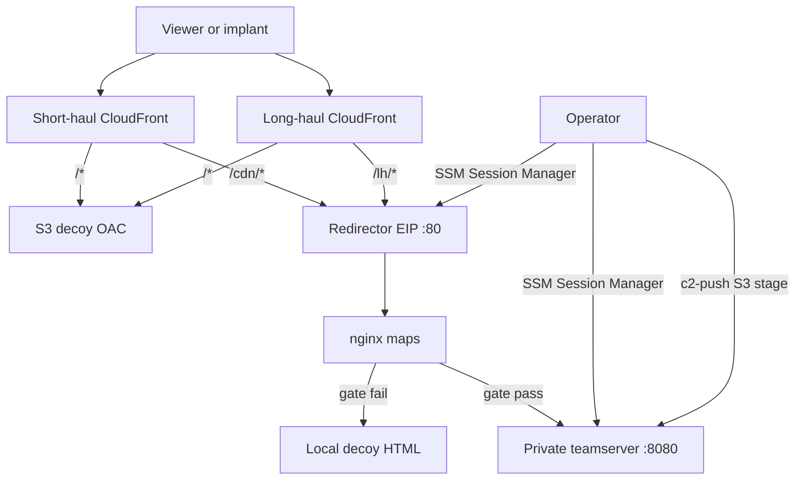

# Architecture

Primary design: two CloudFront **hostnames**, same two EC2s. Each hostname splits origins. Teamserver is private. Admin is SSM.

```text
Internet
   │
   ├─ short-haul dxxxx (or custom alias)
   │     ├─ /*        ──► S3 decoy (OAC, private bucket)
   │     └─ /cdn/*    ──► EIP :80  (SG = CloudFront origin-facing prefix list)
   │                           │
   │                        nginx  (/cdn/ and /lh/ gated the same way)
   │
   └─ long-haul dxxxx (always default cert)
         ├─ /*        ──► same S3 decoy
         └─ /lh/*     ──► same EIP :80
                               │
                            nginx
                               │  header + allowed UA → proxy
                               │  else → local decoy HTML
                               ▼
                         private EC2 :8080  (echo now; BYO C2 via make c2-push)
```



**Identity burn:** replace the redirector instance **and** the EIP. Both CloudFront origins follow the new IP. Both `dxxxx` hostnames stay. S3 stays.

**Hostname burn** (`make burn-hostname`): `-replace=aws_cloudfront_distribution.edge` mints a new short-haul `dxxxx.cloudfront.net`. Long-haul stays. Existing short-haul callbacks die.

Not this repo: Cloudflare Workers, Lambda Function URLs, Packer fleets, inbound SSH, a second EC2 redirector.
